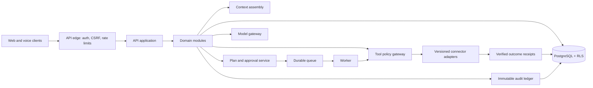

# THAARA V2 architecture

## Purpose and boundaries

Thaara is an executive operating system, not a chat wrapper. It maintains permission-aware context, decomposes requests into explicit plans, stages consequential actions for approval, and records verifiable outcomes. It supports a web application first; chat, voice, and connectors use the same application contracts.

The architecture excludes a recruiting or Talent OS product unless it receives an explicit future scope decision.

## System shape



## Technology decisions

| Concern | Decision | Why |
|---|---|---|
| Repository | pnpm TypeScript monorepo | Shared contracts, one lockfile, independent deployable apps. |
| API | Fastify with TypeBox schemas | Fast, typed JSON-schema validation and OpenAPI generation. |
| Web app | React, Vite, React Router, TanStack Query | Responsive client application with explicit server-state handling. |
| Database | PostgreSQL with versioned SQL migrations and RLS | Transactions, durable concurrency, strong tenant isolation. |
| Queue | Redis and BullMQ | Durable retry, worker leases, delayed work, and idempotent jobs. |
| Object storage | S3-compatible storage | Governed knowledge originals and exports outside database rows. |
| Validation/contracts | TypeBox shared package | One source for API and tool schemas; no client-only types. |
| Authentication | Opaque server-side sessions in secure HttpOnly cookies | Immediate revocation, minimal browser exposure, simple app-to-web security. |
| Observability | OpenTelemetry, structured redacted logs, metrics | Trace request, approval, connector, and worker outcomes without recording secrets. |

No provider is an architectural dependency. Each integration has an adapter behind the tool policy gateway and reports its real configuration and verification state.

## Monorepo layout

```text
apps/
  api/              Fastify HTTP application
  web/              React executive workspace
  worker/           asynchronous plan and connector execution
packages/
  contracts/        versioned API, event, and tool schemas
  db/               migrations, scoped repositories, RLS helpers
  policy/           deterministic authorization/risk/approval checks
  observability/    redaction, tracing, logging conventions
  config/           validated configuration schemas
docs/
  adr/              irreversible or costly decisions
  tasks/            executor-ready implementation tasks
  architecture.md
  requirements-traceability.md
```

## Request and execution lifecycle

1. The edge authenticates the opaque session, protects cookie mutations with CSRF validation, applies route-aware limits, and assigns a correlation ID.
2. The API resolves a request scope: `workspaceId`, `userId`, membership role, and permitted actions. It starts a transaction that sets matching PostgreSQL session variables for RLS.
3. The domain module validates its contract and writes domain records and audit events transactionally.
4. For an executive request, context assembly returns only relevant, fresh, consented, scope-authorized sources with provenance. The model gateway may create a draft or plan proposal.
5. The deterministic policy gateway evaluates action schema, tenant grant, risk, sensitivity, approval mode, idempotency key, rate/volume limits, and connector readiness.
6. Safe reads may execute directly. Mutations create an approval record or a queued plan step. Approval is bound to immutable action parameters and expires.
7. A worker claims a leased job, re-evaluates policy, executes through the adapter, and writes a normalized provider result. It marks a receipt `verified` only after the adapter verifies the claimed outcome; otherwise it records `unverified` or `failed`.

## Tenant, privacy, and authorization model

Every business table contains `workspace_id`; user-owned objects also contain `owner_user_id`. Queries require `RequestScope` and PostgreSQL RLS policies compare row scope to `app.workspace_id`. User access combines membership role and resource attributes such as ownership, visibility, sensitivity, consent, and retention status.

Roles are `owner`, `admin`, `member`, and `viewer`. Role alone does not authorize high-impact work: approval and step-up authentication apply independently. Any failed scope lookup returns an indistinguishable `404` where that reduces resource enumeration.

Memory is typed and consented. Knowledge is versioned, cited, reviewable, and workspace-bound. Expired, deleted, unauthorised, or no-consent records are excluded before model context construction.

## Core state models

| Entity | Allowed states |
|---|---|
| Plan | `draft`, `awaiting_approval`, `queued`, `running`, `paused`, `completed`, `failed`, `cancelled` |
| Plan step | `blocked`, `ready`, `awaiting_approval`, `queued`, `running`, `verified`, `unverified`, `failed`, `skipped`, `cancelled` |
| Approval | `pending`, `claimed`, `approved`, `rejected`, `expired`, `executed`, `execution_failed` |
| Connector | `not_configured`, `connected`, `degraded`, `revoked`, `error` |
| Receipt | `pending`, `accepted`, `verified`, `unverified`, `failed` |

State transitions are transactional and append an immutable audit event. Only services, never browser input, may mark an action `executed` or a receipt `verified`.

## Security and reliability controls

- TLS, security headers, CORS allow-list, request size limits, CSRF protection, distributed limits, session rotation/revocation, and step-up authentication for high-impact approval.
- Server-only connector credentials, envelope encryption with rotation metadata, redacted logging, no raw secrets in audits or telemetry.
- Webhook signature verification, replay windows, idempotency keys, safe URL/egress rules, schema validation, payload limits, and dead-letter queues.
- Per-request database transactions, optimistic concurrency/version fields on mutable records, worker leases, exponential backoff, bounded retries, cancellation, and compensating actions where a provider supports them.
- Tests include cross-workspace negative cases, approval races, replay/idempotency, connector failure truthfulness, prompt injection, memory poisoning, and retention/consent behavior.

## Delivery phases

1. Platform foundation: monorepo, request scope, sessions, database/RLS, audit, policy shell, queue, local stack, CI quality gates.
2. Governed executive core: chat, context, plans, approvals, receipts, memory, knowledge, persona, and tasks.
3. Connectors: Google, WhatsApp, calendar, and one CRM through the same gateway, then live sandbox verification.
4. Voice and proactivity: secure short-lived voice sessions, multilingual streaming, barge-in, confirmations, triggers, quiet hours, and delivery consent.
5. Operations: production PostgreSQL/Redis/object storage, HTTPS, observability, backups/restore test, CI/CD, security scans, and performance testing.

